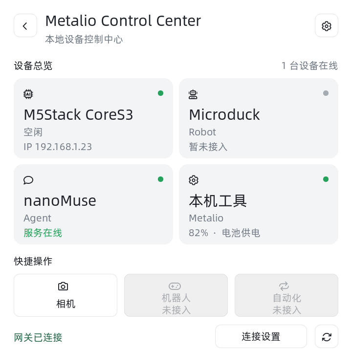
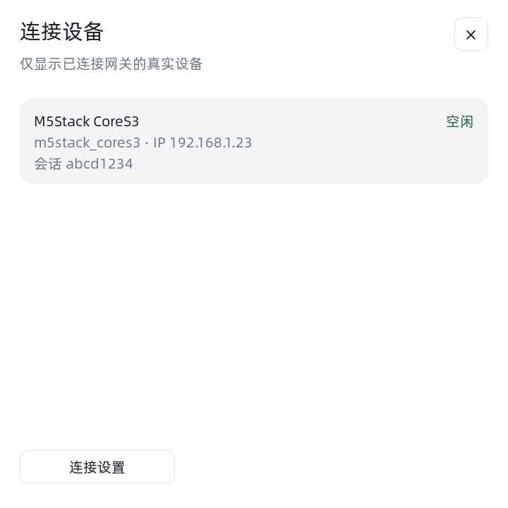
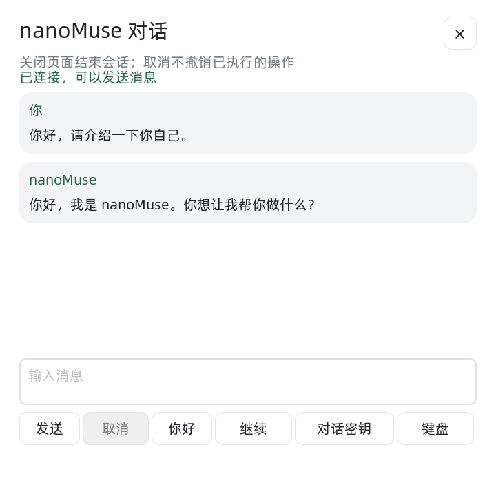

# Metalio 智能设备控制台

在 `feat/device-control-center` 分支上，首页第一个应用为“智能控制台”。
保留原生应用和现有对话协议，不需要 nanoMuse 才能进入控制台或操作本机。

界面采用 720×720 浅色两列卡片布局：设备总览、连接状态点、右上角网关
设置和底部快捷操作。下图来自实际 LVGL 页面本机渲染，电量、设备会话与服务状态为
测试输入，不代表已连接真机。



点击设备卡片后的列表如下，同样使用测试输入：



当前版本支持：

- 查看本机实时电量、充电状态。
- 调节并保存本机亮度、调节扬声器音量。
- 在“连接设置”填写 Gateway 地址与控制台密钥。
- 每五秒从 Gateway 读取真实在线设备；展示空闲、录音、执行、等待审批/回答状态。
- nanoMuse 卡片显示服务在线、启动中、离线、认证失败、未配置或状态不兼容。
- 点击 nanoMuse 卡片打开文字对话，查看回复和执行状态，支持连续追问与取消。
- 断网、认证失败和协议不匹配时清空旧设备列表并显示相应状态。
- 只有一个在线会话时，在首张卡片直接显示设备名称与来源 IP；点击查看
  全部在线会话（最多四个），包含型号、来源 IP、连接 ID 和状态。
- 点击“本机工具”调节亮度、音量，或打开相机、GPS、系统设置。
- 首页“相机”快捷操作直接打开现有相机页面。

Microduck 卡片显示“暂未接入”。nanoMuse 卡片来自网关的独立服务探测，
不依据 Gateway 是否在线推测 nanoMuse 在线。“机器人”和“自动化”快捷按钮禁用，
并显示“未接入”。右上角齿轮与底部“连接设置”均可配置网关；刷新按钮
会立即唤醒后台轮询。

设备列表只包含真实在线会话。配套新版 CoreS3 固件通过可选握手上报板型，
名称显示为 `M5Stack CoreS3`；旧固件仍显示 `Muse Gadget`、`型号未上报`，
可通过来源 IP 辨认。型号来自设备固件声明，不作为硬件认证或权限依据。
来源 IP 是 Gateway 看到的连接对端；经过反向代理时可能是代理地址。
没有上报电量或远程执行能力，不显示猜测的电量或可操作按钮。
重连会生成新 ID；只读控制台不占用 Gateway 的四个对话设备连接名额，
打开文字对话后 Metalio 作为独立对话设备占一个名额。
Microduck、远程设备操作、Metalio 本地任务审批和 AI 自动化尚未接入。

## 配套 Gateway

配套改动位于 `/Workspace/NVME/code/nanomuse-gateway` 的
`feat/metalio-control-center` 分支，新增 `GET /console/devices`。
使用独立的 `METALIO_CONSOLE_KEY`，不把 nanoMuse token 放进设备。

在已有 `.env` 中新增对话用的 `METALIO_DEVICE_KEY` 时，保留原来的
`METALIO_CONSOLE_KEY` 与 `CORES3_DEVICE_KEY`。控制台密钥负责读取所有已连接设备，
对话密钥负责发送文字；新增对话密钥不会替代控制台密钥。

在启动 Gateway 的环境中设置 16 至 127 位无空格 ASCII 密钥：

```bash
export METALIO_CONSOLE_KEY='replace-with-your-own-long-console-key'
# 使用你现有的启动命令、设备密钥与本地配置启动网关。
uv run --locked --env-file .env nanomuse-gateway --config config.toml
```

在 Metalio 的“连接设置”中：

- 地址填写 `http://<电脑局域网IP>:8765`，不附加 `/console/devices`。
- 密钥填写上面的 `METALIO_CONSOLE_KEY`。每次保存连接设置时重新填写密钥。
- 保存空地址会清除网关配置。取消不会修改已保存的设置。

若设备列表突然消失，可在电脑执行：

```bash
curl -i http://127.0.0.1:8765/console/devices
```

不带密钥时返回 `401` 表示接口已配置；返回 `503` 且正文为
`console not configured`，表示当前 Gateway 进程未加载控制台密钥。
在本机 `.env` 恢复原 `METALIO_CONSOLE_KEY`（或 `[console].key_env` 指定的变量），
再用下述 `--env-file .env` 命令重启 Gateway。若换了新值，Metalio 的“连接设置”
也填写相同的新值；“对话密钥”仍填写 `METALIO_DEVICE_KEY`。

```bash
cd /Workspace/NVME/code/nanomuse-gateway
uv run --locked --env-file .env nanomuse-gateway --config config.toml
```

设置保存在本机 NVS `device_hub` 命名空间；密钥输入以密码形式显示，不写入日志。
客户端复用板卡的网络接口，网络请求放在后台任务，退出控制台后暂停轮询。
仅在可信局域网使用 HTTP；其他网络使用有可信证书的 HTTPS。
Gateway 或 nanoMuse 不在线时，本机控制和原生应用仍可使用。

### 怎么接 nanoMuse

CoreS3 和 Metalio 都可通过 Gateway 与 nanoMuse 对话，使用独立会话。
Metalio 通过同一个 Gateway 查看设备列表、nanoMuse 服务状态并发送文字。

现有 CoreS3 对话链路如下：

```text
CoreS3 → Gateway（8765）→ nanoMuse（8787）
Metalio → Gateway（8765，读取设备清单与 nanoMuse 服务状态）
Metalio → Gateway /device（WebSocket，文字对话）→ nanoMuse
```

1. 在电脑打开 `http://127.0.0.1:8787`，确认 nanoMuse 网页可以正常文字对话。
   如果服务尚未启动，按 nanoMuse 自身的部署方式启动；已有服务无需重复启动。
2. 在 Gateway 的现有 `config.toml` 中核对 `[nanomuse]` 配置。两者运行于同一
   台主机、且 Gateway 直接在主机运行时，地址为：

   ```toml
   [nanomuse]
   url = "http://127.0.0.1:8787"
   token_env = "NANOMUSE_SERVER_TOKEN"
   ```

   如果 nanoMuse 在另一台电脑，改为那台电脑可访问的地址；Gateway 在容器内时，
   `127.0.0.1` 指向容器自身，需要改为容器可访问的 nanoMuse 地址。
3. 在 Gateway 本机 `.env` 设置 `NANOMUSE_SERVER_TOKEN` 为 nanoMuse 的
   **server token**，保留已有 `CORES3_DEVICE_KEY` 与 `METALIO_CONSOLE_KEY`。
   server token 可从 nanoMuse 自己的启动/配对信息或其数据目录的 `server_token`
   文件获取，只配置在网关，不填入 Metalio，也不要发到聊天里。
4. 在 Gateway 原终端停止旧进程，使用相同目录和配置重新启动：

   ```bash
   cd /Workspace/NVME/code/nanomuse-gateway
   uv run --locked --env-file .env nanomuse-gateway --config config.toml
   ```

5. CoreS3 的网关地址使用 `ws://电脑局域网IP:8765/device`，密钥使用
   `CORES3_DEVICE_KEY`。发送一条文字验证完整链路；按键语音还需要配置 ASR/TTS。
   Metalio 则继续使用 `http://电脑局域网IP:8765` 与控制台密钥查看设备。

网关 `/health` 成功只表示网关存活，nanoMuse 网页能打开也不代表模型已经可用。
在 CoreS3 成功得到回答后，才能确认设备、Gateway、nanoMuse 和模型的对话链路。

### 在 Metalio 查看 nanoMuse 在线状态

1. 在 Gateway 的原终端停止旧进程，用上面的命令启动当前源码。保留现有
   nanoMuse URL、server token、设备密钥和控制台密钥；无需新增配置。
2. 烧录当前 Metalio 固件，进入智能控制台。沿用已有 Gateway 地址和控制台
   密钥，点击右下角刷新。此功能不要求重刷 CoreS3。

| 卡片提示 | 含义与处理 |
| --- | --- |
| 服务在线（绿点） | nanoMuse 健康与认证检查通过；不代表模型、ASR/TTS 已验证。 |
| 服务启动中（黄点） | nanoMuse 仍在初始化，稍后自动更新。 |
| 服务离线（灰点） | Gateway 无法连接 nanoMuse、请求超时或服务端错误；检查服务和 URL。 |
| nanoMuse 认证失败（红点） | nanoMuse 拒绝 Gateway 的 server token；在电脑端修正。 |
| 网关未配置 token（红点） | 在 Gateway 环境配置 `NANOMUSE_SERVER_TOKEN` 后重启。 |
| 网关需更新 | 当前网关尚未提供服务状态字段，需使用新版源码重启。 |
| 服务状态不兼容（红点） | 健康接口或响应格式不兼容，检查服务版本和地址。 |
| 网关未连接／密钥不正确等 | Metalio 尚未读到网关，卡片清除旧服务状态并提示对应网关问题。 |

状态随现有设备轮询刷新。Gateway 的结果缓存五秒，多台控制台共享一次探测；
两个只读请求合计限时两秒，nanoMuse 故障时设备清单仍能返回。
右上角数量只统计实际设备会话，nanoMuse 服务不计入其中。
Metalio 不保存 nanoMuse server token，也不会为显示状态发送对话或模型请求。

### 在 Metalio 与 nanoMuse 文字对话

1. 按上面的方法启动 nanoMuse 与当前 Gateway，并确认 nanoMuse 网页能正常回答。
2. 烧录当前 Metalio 固件，在“连接设置”中保存 Gateway 的 HTTP 地址与控制台密钥。
3. 在 Gateway 的本机 `.env` 中设置 `METALIO_DEVICE_KEY`，选一个独立的
   16–127 位无空格 ASCII 密钥，然后重启当前版本 Gateway。已有 CoreS3 密钥保持原值。
   点击 nanoMuse 卡片，在“对话密钥”中填入 `METALIO_DEVICE_KEY` 的实际值。此处不能填
   `METALIO_CONSOLE_KEY` 或 nanoMuse server token。
4. 保存后等待“已连接，可以发送消息”。点“你好”填入示例，或点“键盘”输入文字，
   再点“发送”。软键盘为现有英文键盘；中文“你好”“继续”按钮填入常用句，首版不含拼音输入。
5. 页面显示“正在发送”“正在执行，等待回复”，完成后展示 nanoMuse 回复，可继续追问。
   发送会收起键盘；点“键盘”可再次展开，回复区域可以滚动。
6. “取消”停止当前请求，并忽略之后迟到的回复。需要审批的任务显示内容与等待状态，
   请在 nanoMuse 网页确认或拒绝，本版不在 Metalio 上发送授权决定。



对话使用同一 Gateway 地址转换得到的 `ws://电脑IP:8765/device`，HTTPS 转为 WSS。
对话密钥独立保存在 NVS `device_hub.chat_key`，密码框不回填已存值；保存空值会清除。
它与只读控制台密钥分开，不保存或打印 nanoMuse token。
Gateway 默认读取 `METALIO_DEVICE_KEY`；可在 `config.toml` 的已有 `[gateway]`
段中添加 `metalio_key_env = "METALIO_DEVICE_KEY"` 自定义环境变量名。
Metalio 与 CoreS3 可以使用不同密钥；只接 Metalio 时可以不设置 `CORES3_DEVICE_KEY`。
更新 Gateway 之前的版本只接受原设备密钥，需要先更新再使用 Metalio 独立密钥。
密钥仍使用相同设备协议和权限，设备型号由连接后单独上报。
Metalio 会上报 `metalio_claw_4`，新网关设备清单显示 `Metalio Claw 4`，
nanoMuse 中新建的线程标题为 `Metalio`，CoreS3 对话保持独立。

同一连接连续对话保留 nanoMuse 上下文；关闭页面结束连接并清空本机页面记录，
不会删除 nanoMuse 已有历史。自动重连会开始新的上游会话，不重新发送旧请求，
页面会提示上下文变化。取消、关闭页面或网络中断不能撤销已完成的外部操作。
页面最多保留最近 12 条消息，单条输入最多 1000 个字符且不超过 4000 UTF-8 字节；
回复按网关的 6000 字节上限处理。无新进展 180 秒或整轮 900 秒会取消并提示超时。
这条链路无需 CoreS3 在线，不需要更改 CoreS3 固件。

| 现象 | 检查 |
| --- | --- |
| 对话断开 | 对话设备密钥、网络、同一个 Gateway 地址，以及四个设备连接名额是否已用满。 |
| 网关已连接但发不出去 | 控制台只读连接和文字对话是独立认证；先填写对话设备密钥并等待握手成功。 |
| nanoMuse 认证失败或模型报错 | 电脑端 nanoMuse token、服务地址、模型；页面显示 Gateway 返回的错误提示。 |
| 需要审批 | 到 nanoMuse 网页处理；Metalio 显示等待状态，不能自动批准。 |
| 没有语音 | 本版仅接文字，录音与播报尚未适配。 |

### 没看到 CoreS3 时

显示“1 台在线”表示已经读到一个真实在线会话；若名称是 `Muse Gadget`，
表示设备尚未上报型号。点击首张卡片查看来源 IP、连接 ID 和状态。
可以对照 CoreS3 的 Wi-Fi 地址，或暂时关闭 CoreS3，观察数量是否从 1 变为 0。

要让控制台直接显示 `M5Stack CoreS3`，需要三处更新：

1. 在 `nanomuse-gateway` 使用当前源码，并在原终端重启网关，保留原有环境与配置。
2. 为 CoreS3 烧录 `muse-gadget-sdk` 当前源码生成的 nanoMuse 固件，重新连接网关。
3. 为 Metalio 烧录当前控制台固件，打开控制台并刷新。

CoreS3 在收到网关 `hello.device_identity: true` 后发送
`{"type":"identify","model":"m5stack_cores3"}`。旧网关不会收到新消息；
旧 CoreS3 固件仍能连接新版网关，只是不显示具体型号。
仅更新网关和 Metalio 时，旧设备可以显示来源 IP。

先区分两段连接：CoreS3 通过 WebSocket 连接 Gateway；Metalio 再通过 HTTP
读取 Gateway 的设备列表。CoreS3 已连接不代表 Metalio 也已连接。

| Metalio 显示 | 检查内容 |
| --- | --- |
| 网关已连接，有在线设备 | 点击首张卡片查看 IP 和型号；旧固件可能仅显示通用名称。 |
| 网关已连接，0 台在线 | CoreS3 必须连接同一个电脑、同一个端口的 `/device`，并使用设备密钥。 |
| 网关未连接／正在连接 | Metalio 使用可访问电脑局域网 IP 的 Wi-Fi；本板默认网络为 4G，需要在网络页确认当前模式。检查地址、端口与防火墙。 |
| 网关密钥不正确 | Metalio 填独立控制台密钥，CoreS3 填设备密钥，两者不要混用。 |
| 网关返回格式不兼容 | 确认运行的是带 `/console/devices` 接口的 Gateway 版本。 |

Metalio 地址形如 `http://电脑局域网IP:8765`，CoreS3 地址形如
`ws://电脑局域网IP:8765/device`。设备端不能填电脑的 `127.0.0.1`。
打开控制台后每五秒更新一次，也可以点右下角刷新。

## 编译与烧录

```bash
source /home/verachen/esp/v5.5.4/export.sh
idf.py build
idf.py -p /dev/ttyACM0 flash monitor
```

串口替换为实际 P4 端口。根目录 `Metalio_Claw4_Latest.bin` 是上游预编译文件，
不包含本分支新增的控制台；应烧录本分支的编译产物。已有设备从原 Beaver
固件迁移到上游双系统分区时，应先按上游烧录说明安装完整匹配的固件布局。

CoreS3 使用独立仓库与 ESP-IDF 6.0.1，辅助脚本会选择对应工具链：

```bash
cd /Workspace/NVME/code/muse-gadget-sdk
esp32/tools/nanomuse.sh build
esp32/tools/nanomuse.sh -p /dev/CORE_S3_PORT flash monitor
```

将 `/dev/CORE_S3_PORT` 替换为 CoreS3 的真实端口，不能使用 Metalio 的 P4 端口。
产物位于 `esp32/build-nanomuse-cores3/`；保留现有 Wi-Fi 与 Gateway 配置。

### 本次验证边界

配套网关的 140 项回归测试通过，其中 13 项覆盖控制台，并验证 Metalio 与 CoreS3
独立线程及连续文字对话；CoreS3 主机测试此前
共运行 589 项、跳过 4 项，本次服务状态功能不修改 CoreS3。
新增页面与客户端使用仓库实际 LVGL 9.3、
字体和控件代码完成本机编译与运行检查，覆盖参数校验、响应大小限制、认证
失败、清除旧设备、亮度/音量、连接对话框、语言切换及退出清理。
模拟运行中的电量和设备条目是测试输入，不代表已连接真机。
卡片版另外验证四个会话的完整列表、认证失效后清除会话、弹窗替换、
打开弹窗时销毁页面，以及相机入口的页面切换；AddressSanitizer 检查通过。
型号版覆盖旧版响应缺少型号/IP、新版字段解析与错误类型拒绝，并完成界面渲染检查。
服务状态版验证在线/启动/离线/认证/未配置/旧网关/异常字段、认证失效后清除旧状态、
设备数量独立计数以及中英文页面；网关覆盖探测超时、并发缓存、断线恢复、
未授权不探测、超大健康响应及拒绝重定向。
文字版通过 `python3 scripts/test_nanomuse_chat.py` 编译运行实际 C++ 客户端，
覆盖独立设备密钥、握手、发送、回复、审批等待、进度去重、取消后的旧回复、旧连接回调、
断线不重发、超时、协议错误、消息限额和退出清理，使用 AddressSanitizer 与 UndefinedBehaviorSanitizer。
实际 LVGL 对话页还验证密钥表单、发送/取消、回复、键盘展开、中英文按钮与退出页面清理。

2026-10-30 使用 ESP-IDF 5.5.4 和仓库现有 ESP32-P4 配置完整编译通过，
生成文字对话版 `build/xiaozhi.bin`（大小 `0x8ab460`，烧录地址 `0x200000`）。
建议使用上述 `idf.py flash`，由构建系统同时处理相应分区表、资源和模型。
CoreS3 也使用 ESP-IDF 6.0.1 完整编译通过。尚未实际烧录或进行真机测试。

构建中的 `ota_1` 容量警告来自仓库的双系统布局：主固件放在 9 MiB 的
`ota_0`，4 MiB 的 `ota_1` 留给 ESPClaw，不用于本次主固件镜像。

### 依赖配置错误的处理

Component Manager 2.4.10 的版本更新提示会额外解析新版 `esp_video`，并将其
`ESP_VIDEO_USE_CUSTOMIZED_ESP_H264_VERSION` 缺失记录带入当前构建。
锁文件使用的 `esp_video 2.3.0` 没有这个配置项，因而反复配置仍会失败。
项目根目录 `CMakeLists.txt` 已设置 `IDF_COMPONENT_CHECK_NEW_VERSION=0`，
关闭这项更新提示；依赖下载、校验和正常解析继续工作，保留原有锁定版本。
无需在 `sdkconfig` 中添加无定义的选项，也无需修改全局 ESP-IDF 安装。

## 后续接入

下一阶段为 Gateway 增加设备适配器和明确的能力清单，再向控制台开放对应操作。
机器人只提供经确认的高层技能与停止接口，运动闭环仍由机器人本地处理。
是否接 nanoMuse 与设备基础控制分开配置。
